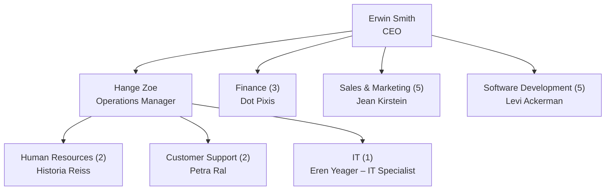

# Departments and Employees

| Field | Value |
|---|---|
| Document ID | CO-REF-002 |
| Owner | IT Specialist |
| Status | Approved |
| Last reviewed | 2026-11-26 |

Source of truth for people: [data/employees.csv](data/employees.csv). The
tables below summarise it; if they disagree, the CSV wins (CI checks the counts).

## 1. Organisation chart

## 2. Headcount by department

| Department | Headcount | Manager | Work model | Data sensitivity |
|---|---:|---|---|---|
| Management | 2 | CEO | Hybrid / office | High – contracts, strategy |
| Finance | 3 | Finance Manager | Office | **Very high** – banking, payroll, invoices |
| Human Resources | 2 | HR Manager | Office / hybrid | **Very high** – personal data (GDPR special care) |
| Sales & Marketing | 5 | Sales & Marketing Manager | Hybrid | Medium – CRM, proposals |
| Software Development | 5 | Development Team Lead | Hybrid | High – source code, client systems access |
| Customer Support | 2 | Customer Support Lead | Office | Medium – client tickets |
| IT | 1 | Operations Manager | Office | **Very high** – admin credentials |
| **Total** | **20** | | | |

## 3. Department IT needs

### Management

- Mobile-first: laptop + company phone e-mail (MFA app), board documents in SharePoint.
- Needs delegated calendar access (Operations Manager manages CEO calendar).
- Approves IT budget and changes classed as *major*.

### Finance

- Accounting software (desktop client, connects to vendor cloud) and e-banking
  over the web – **requires the most restrictive access** to its file share.
- Dedicated mono laser printer **in the Finance office** for payroll and
  confidential documents (`TC-PRN02`).
- Office-based; no data leaves the company except via approved channels.

### Human Resources

- Employee records, contracts and payroll inputs – personal data under GDPR.
- Drives **onboarding and offboarding requests** to IT (see future `12-policies-procedures`).
- Needs a private room for interviews (Meeting Room 2) with Teams video.

### Sales & Marketing

- CRM (SaaS), proposals in SharePoint, heavy Teams/Outlook use, often on the road.
- Marketing Specialist needs a higher-spec *Creative* laptop and Adobe Creative Cloud.
- Uses the guest Wi-Fi to demo for visiting clients – must not reach internal systems.

### Software Development

- *Developer* tier laptops (32 GB RAM) with local admin **via a separate
  elevation process**, not by default.
- Git hosting (SaaS), Docker Desktop / WSL2, VPN access to client environments.
- Source code must never be stored on the file server or USB drives.

### Customer Support

- Shared mailbox `support@` for client tickets, softphone / Teams calling, headsets.
- Office-based; needs high availability during 08:30–18:00.

### IT

- One person (me). Separate privileged account, access to all infrastructure.
- Needs a documented escalation path to external vendors (ISP, hardware
  warranty, Microsoft partner) because there is no second IT person.

## 4. Employee directory

| ID | Name | Username | Department | Job title | Work model | Device tier | Laptop |
|---|---|---|---|---|---|---|---|
| E001 | Erwin Smith | erwin.smith | Management | Chief Executive Officer | Hybrid | Standard | TC-LT-001 |
| E002 | Hange Zoe | hange.zoe | Management | Operations Manager | Office | Standard | TC-LT-002 |
| E003 | Dot Pixis | dot.pixis | Finance | Finance Manager | Office | Standard | TC-LT-003 |
| E004 | Nile Dok | nile.dok | Finance | Accountant | Office | Standard | TC-LT-004 |
| E005 | Hitch Dreyse | hitch.dreyse | Finance | Payroll & Accounts Officer | Office | Standard | TC-LT-005 |
| E006 | Historia Reiss | historia.reiss | Human Resources | HR Manager | Hybrid | Standard | TC-LT-006 |
| E007 | Sasha Blouse | sasha.blouse | Human Resources | HR & Office Coordinator | Office | Standard | TC-LT-007 |
| E008 | Jean Kirstein | jean.kirstein | Sales & Marketing | Sales & Marketing Manager | Hybrid | Standard | TC-LT-008 |
| E009 | Connie Springer | connie.springer | Sales & Marketing | Account Executive | Hybrid | Standard | TC-LT-009 |
| E010 | Reiner Braun | reiner.braun | Sales & Marketing | Account Executive | Hybrid | Standard | TC-LT-010 |
| E011 | Pieck Finger | pieck.finger | Sales & Marketing | Marketing Specialist | Hybrid | Creative | TC-LT-011 |
| E012 | Bertolt Hoover | bertolt.hoover | Sales & Marketing | Business Development Representative | Hybrid | Standard | TC-LT-012 |
| E013 | Levi Ackerman | levi.ackerman | Software Development | Development Team Lead | Hybrid | Developer | TC-LT-013 |
| E014 | Armin Arlert | armin.arlert | Software Development | Senior Software Developer | Hybrid | Developer | TC-LT-014 |
| E015 | Mikasa Ackerman | mikasa.ackerman | Software Development | Software Developer | Hybrid | Developer | TC-LT-015 |
| E016 | Annie Leonhart | annie.leonhart | Software Development | Software Developer | Hybrid | Developer | TC-LT-016 |
| E017 | Porco Galliard | porco.galliard | Software Development | QA Engineer | Hybrid | Developer | TC-LT-017 |
| E018 | Petra Ral | petra.ral | Customer Support | Customer Support Lead | Office | Standard | TC-LT-018 |
| E019 | Oluo Bozado | oluo.bozado | Customer Support | Customer Support Specialist | Office | Standard | TC-LT-019 |
| E020 | Eren Yeager | eren.yeager | IT | IT Specialist *(the role played in this lab)* | Office | IT | TC-LT-020 |

The cast is borrowed from the characters of the anime *Attack on Titan* (names only, used as a fun fictional cast – no affiliation). E-mail = `<username>@techcorp.example`. Two people share the surname Ackerman, which is why usernames are always `firstname.lastname` and never just the surname.
