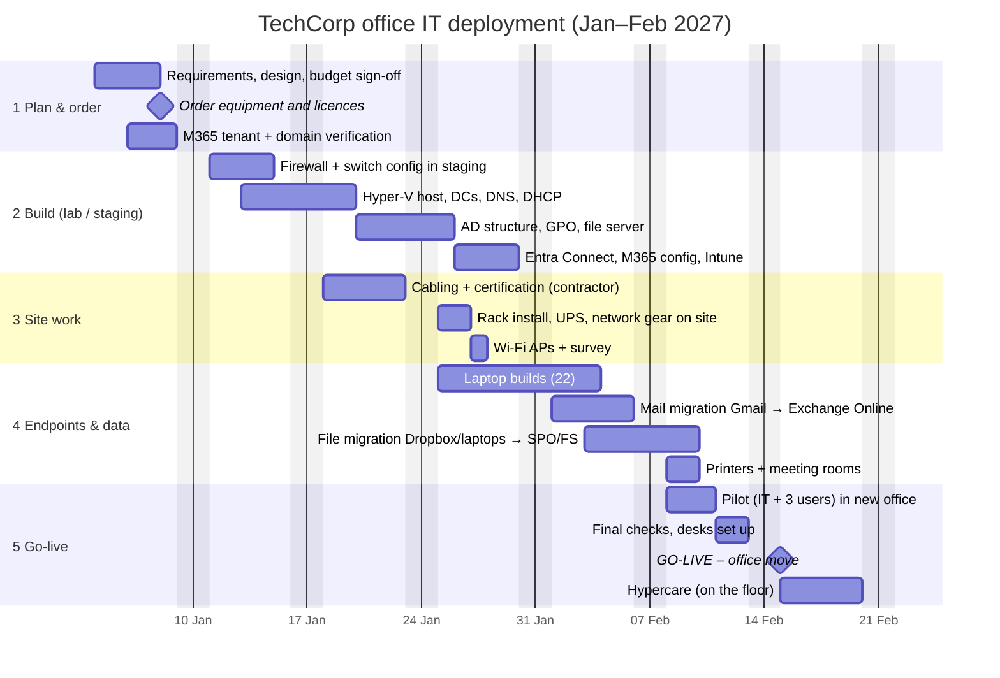

# Office IT Deployment Plan

| Field | Value |
|---|---|
| Document ID | DEP-REF-001 |
| Owner | IT Specialist |
| Sponsor | Sofia Dimitriou, Operations Manager |
| Status | Approved |
| Last reviewed | 2026-11-26 |
| Related requirements | BR-01 – BR-33 (all), especially BR-33 |

## 1. Objective

Have the complete IT environment for 20 employees **working on the morning
of Monday 15 February 2027**, the day TechCorp moves into the new office,
with no more than one working day of disruption (BR-33).

## 2. Scope

| In scope | Out of scope |
|---|---|
| Structured cabling, rack, network, Wi-Fi | Building works, electrical (landlord) |
| Firewall, VLANs, internet + failover, VPN | Telephony beyond Teams |
| Hyper-V host, 2 DCs, file server, NAS, UPS | Line-of-business app configuration (vendors) |
| AD DS, Group Policy, file shares | |
| Microsoft 365 tenant, mail migration from Gmail | |
| 22 laptops, 24 desks, 2 meeting rooms, 2 printers | |
| Data migration from personal laptops / Dropbox | |
| User training and first-week hypercare | |

## 3. Timeline

## 4. Phases, deliverables and exit criteria

| Phase | Deliverables | Exit criteria (gate) |
|---|---|---|
| 1. Plan & order | Approved design, purchase orders, tenant, domain DNS verified | Budget signed off; all items ordered by 8 Jan |
| 2. Build in staging | Firewall/switch configs, servers, AD, GPO, M365 configured | Test laptop on VLAN 20 logs on to domain, gets M365, maps share, prints to test queue |
| 3. Site work | 44 certified drops, rack populated, APs installed | Certification report 100 % pass; every active drop links up on the expected switch port |
| 4. Endpoints & data | 22 laptops built, mail + files migrated | Build checklist complete per laptop; mailbox item counts match; spot-checks of migrated files OK |
| 5. Pilot | 4 users working from new office for 3 days | No open P1/P2 issues; pilot feedback addressed |
| Go-live | All staff working | 20/20 users signed in, MFA registered, printing, Teams calls OK |
| Hypercare | Floor-walking, issue log | Ticket volume back to normal; lessons learned written |

## 5. Cut-over plan (weekend 13–14 Feb)

| When | Task | Rollback point |
|---|---|---|
| Fri 12 Feb 17:30 | Freeze: no new data in Dropbox / Gmail | – |
| Fri 18:00 | Final Gmail → Exchange delta sync; switch MX record to Exchange Online (TTL lowered to 5 min on 1 Feb) | Revert MX to Gmail |
| Sat 10:00 | Final Dropbox → SharePoint delta copy; Dropbox set read-only | Dropbox still intact |
| Sat 14:00 | Desks: docks, monitors, cable management, desk labels | – |
| Sun 10:00 | Full test pass: each desk drop, each AP, printers, meeting rooms | – |
| Sun 16:00 | Go / no-go call with Operations Manager | Delay move-in by one day (agreed with landlord) |
| Mon 08:00 | IT at reception – laptop hand-out, MFA enrolment desk | – |

## 6. Risks

| # | Risk | Likelihood | Impact | Mitigation | Owner |
|---|---|:-:|:-:|---|---|
| R1 | Laptop delivery late | M | H | Order day 4; 2 spares; existing laptops temporarily enrolled | IT |
| R2 | ISP fibre not active on move date | M | H | Order 6 weeks ahead; 4G/5G failover works as primary temporarily | IT |
| R3 | Cabling not finished / fails certification | L | H | Contractor penalty clause; certification in week 3 leaves 3 weeks buffer | Ops Mgr |
| R4 | Mail migration loses items | L | H | Pilot migration of 2 mailboxes first; item count comparison; Gmail kept 90 days | IT |
| R5 | Users not ready for MFA | H | M | MFA enrolment desk at go-live; printed quick guide | IT |
| R6 | Single IT person off sick during cut-over | L | H | Every step documented here; Microsoft partner on call for go-live weekend | Ops Mgr |
| R7 | Personal data found on personal laptops | M | M | Migration interview per user; only work data copied; GDPR-aware process | IT / HR |

## 7. Communication plan

| When | Audience | Message | Channel |
|---|---|---|---|
| 11 Jan | All staff | What is changing and when; new accounts coming | All-hands + e-mail |
| 25 Jan | All staff | Prepare: tidy your files, list software you need | E-mail |
| 5 Feb | All staff | Go-live guide: first-day sign-in, MFA, where to get help | E-mail + printed |
| 12 Feb | All staff | Freeze reminder: stop using Dropbox/Gmail after 17:30 | E-mail + Teams |
| 15 Feb | All staff | Welcome to the new office – IT desk at reception | In person |
| 22 Feb | Management | Deployment report and lessons learned | Report (`16-reports/deployment`) |

## 8. Related documents

- [Office floor plan](office-floor-plan.md)
- [Equipment list and budget](../equipment-inventory/equipment-list.md)
- [Cabling plan](../network-installation/cabling-plan.md)
- [Network topology](../../02-network-infrastructure/topology/network-topology.md)
- [IP addressing plan](../../02-network-infrastructure/ip-addressing/ip-addressing-plan.md)
- [Workstation standard](../workstation-deployment/workstation-standard.md)
- [Master deployment checklist](../deployment-checklist.md)
