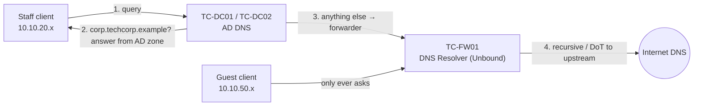

# DNS Design and Configuration

| Field | Value |
|---|---|
| Document ID | NET-PRC-005 |
| Owner | IT Specialist |
| Status | Draft – internal part becomes Approved after lab execution; AD part completed in Phase 2 |
| Last reviewed | 2026-11-26 |
| Related requirements | BR-01, BR-02, BR-15, BR-19 |

## 1. Namespaces

| Name | Type | Served by | Purpose |
|---|---|---|---|
| `techcorp.example` | Public | Registrar / public DNS host | Website, e-mail (MX, SPF, DKIM, DMARC), M365 records |
| `corp.techcorp.example` | Internal (AD) | TC-DC01, TC-DC02 (AD-integrated, from Phase 2) | Domain logon, SRV records, internal hosts |
| `10.10.in-addr.arpa` | Internal reverse | DCs (from Phase 2) | PTR records for troubleshooting |

Using a **sub-domain of a domain we own** for AD (instead of `techcorp.local`
or the bare public name) means:

- no **split-brain DNS** – the public zone and the AD zone never have to hold the same names;
- `.local` conflicts with mDNS/Bonjour and cannot get public TLS certificates.

## 2. Resolution path



| Phase | Clients use | Firewall resolver | DCs |
|---|---|---|---|
| **Milestone 4 (now)** | Firewall `10.10.x.1` | Recursive resolver; host overrides for infrastructure names | not yet built |
| **Phase 2 onward** | DCs `10.10.30.11`, `.12` (DHCP option 6 changed) | Serves guests + is the forwarder for the DCs | AD-integrated zones, forwarder → `10.10.30.1` |

Why the DCs forward to the firewall rather than straight to the internet:
one egress point for DNS, one place to add filtering (Phase 9), and the DCs
need no outbound UDP/TCP 53 rule.

## 3. Procedure – firewall DNS Resolver (now)

1. **Services → DNS Resolver → General**: Enable; *Network interfaces* = MGMT,
   STAFF, SERVERS, PRINTERS, GUEST, localhost; *Outgoing interfaces* = WAN, WAN2.
2. Tick **DHCP Registration** and **Static DHCP** – lab clients become
   resolvable by hostname before AD exists.
3. **Host overrides** (`corp.techcorp.example`):

   | Host | IP |
   |---|---|
   | tc-fw01 | 10.10.10.1 |
   | tc-sw01 | 10.10.10.2 |
   | tc-ups01 | 10.10.10.5 |
   | tc-ap01 / ap02 / ap03 | 10.10.10.11 / .12 / .13 |
   | tc-hv01 | 10.10.30.10 |
   | tc-nas01 | 10.10.30.30 |
   | tc-prn01 / prn02 | 10.10.40.10 / .11 |

4. **Domain override (prepared, enabled in Phase 2):** domain
   `corp.techcorp.example` → `10.10.30.11` and `10.10.30.12`, so guests and the
   firewall itself can resolve AD names if ever needed (guests are still blocked by rules).
5. **System → General Setup**: DNS servers `1.1.1.1`, `9.9.9.9`; untick
   *Allow DNS server list to be overridden by DHCP/PPP on WAN*.
6. Optional hardening (Phase 9): *DNS over TLS* forwarding to upstream, DNSSEC on.

## 4. Public DNS records (prepared for Phase 5)

Values are examples for the fictional domain; real ones come from the M365 admin centre.

| Type | Name | Value | Purpose |
|---|---|---|---|
| MX | `@` | `techcorp-example.mail.protection.outlook.com` (pri 0) | Mail to Exchange Online |
| TXT | `@` | `v=spf1 include:spf.protection.outlook.com -all` | SPF – only M365 may send |
| CNAME | `selector1._domainkey` | `selector1-techcorp-example._domainkey.<tenant>.onmicrosoft.com` | DKIM |
| CNAME | `selector2._domainkey` | `selector2-techcorp-example._domainkey.<tenant>.onmicrosoft.com` | DKIM |
| TXT | `_dmarc` | `v=DMARC1; p=quarantine; rua=mailto:dmarc@techcorp.example` | DMARC (start `p=none` for 2 weeks) |
| CNAME | `autodiscover` | `autodiscover.outlook.com` | Outlook auto-configuration |
| A | `vpn` | `203.0.113.10` | Remote-access VPN endpoint |

TTL: 3600 s normally; lowered to 300 s one week before the e-mail cut-over.

## 5. Verification

```powershell
Resolve-DnsName tc-sw01.corp.techcorp.example        # host override → 10.10.10.2
Resolve-DnsName www.microsoft.com                    # recursion works
Resolve-DnsName 10.10.10.2 -Type PTR                 # reverse (after Phase 2)
nslookup -type=SRV _ldap._tcp.dc._msdcs.corp.techcorp.example   # Phase 2
Get-DnsClientServerAddress -AddressFamily IPv4       # which DNS server the client uses
```

| Check | Expected |
|---|---|
| From STAFF | Infrastructure names resolve; public names resolve |
| From GUEST | Public names resolve; `tc-sw01.corp.techcorp.example` may resolve but **connection is blocked** by rules (names are not secrets – rules are the control) |

## 6. Troubleshooting

| Symptom | Likely cause | Fix |
|---|---|---|
| `ping 1.1.1.1` works, `ping microsoft.com` fails | DNS, not routing | `Resolve-DnsName`, check DNS option, resolver running |
| Short names (`tc-sw01`) don't resolve | Missing DNS suffix | DHCP option 15 / suffix search list |
| Old IP returned after a change | Client cache | `ipconfig /flushdns`; *Diagnostics → DNS Lookup* on pfSense |
| Domain join fails "domain could not be contacted" (Phase 2) | Client points to firewall, not DCs | DNS must be the DCs for domain members |
| Resolver fails only on WAN2 | Outgoing interfaces list missing WAN2 | Add WAN2 |
