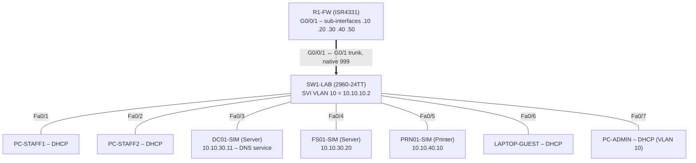

# Packet Tracer Lab – Switching and Router-on-a-Stick

| Field | Value |
|---|---|
| Document ID | NET-PRC-007 |
| Owner | IT Specialist |
| Status | Draft – configs written, not yet pasted into Packet Tracer (evidence pending) |
| Last reviewed | 2026-11-26 |

VirtualBox cannot simulate a managed switch, so the **switch CLI** part of
TechCorp's network is practised in Cisco Packet Tracer. A small ISR router plays
the role of the firewall (router-on-a-stick) so tagging, trunks and inter-VLAN
routing can be seen end to end.

| File | Device |
|---|---|
| [sw1-lab.txt](sw1-lab.txt) | `SW1-LAB` – 2960-24TT, stand-in for TC-SW01 (same VLANs, same hardening ideas) |
| [r1-fw-lab.txt](r1-fw-lab.txt) | `R1-FW` – ISR4331, stand-in for TC-FW01 (sub-interfaces, DHCP pools, ACLs) |

## 1. Topology to build

## 2. Steps

1. Place the devices above; cable with **copper straight-through** (router
   G0/0/1 ↔ switch G0/1 too).
2. Static IPs: DC01-SIM `10.10.30.11/24` gw `.1`; FS01-SIM `10.10.30.20/24`;
   PRN01-SIM `10.10.40.10/24` gw `10.10.40.1`.
3. On DC01-SIM enable **Services → DNS** and add A records:
   `tc-sw01.corp.techcorp.example → 10.10.10.2`,
   `tc-fs01.corp.techcorp.example → 10.10.30.20`.
4. Paste `sw1-lab.txt` into SW1-LAB, then generate the RSA key (see end of file).
5. Paste `r1-fw-lab.txt` into R1-FW.
6. Set every PC/laptop to **DHCP** (*Desktop → IP Configuration*).
7. Save the file as `techcorp-network-lab.pkt` (outside the repo or attach to the GitHub release – not committed as a binary).

## 3. Verification

| # | Where | Command / action | Expected |
|---|---|---|---|
| 1 | SW1-LAB | `show vlan brief` | VLANs 10/20/30/40/50/999, Fa0/1-2 in 20, Fa0/8-24 in 999 |
| 2 | SW1-LAB | `show interfaces trunk` | Gi0/1 trunking, native 999, allowed 10,20,30,40,50 |
| 3 | R1-FW | `show ip interface brief` | Five sub-interfaces up/up |
| 4 | R1-FW | `show ip dhcp binding` | Leases for STAFF, GUEST, ADMIN PCs |
| 5 | PC-STAFF1 | `ipconfig` | 10.10.20.50+ / gw 10.10.20.1 / DNS 10.10.30.11 |
| 6 | PC-STAFF1 | `ping 10.10.30.11` | ✅ replies (inter-VLAN routing) |
| 7 | PC-STAFF1 | `nslookup tc-sw01.corp.techcorp.example` | 10.10.10.2 |
| 8 | PC-STAFF1 | `ssh -l netadmin 10.10.10.2` | ❌ blocked by STAFF-IN and the switch vty ACL |
| 9 | PC-ADMIN | `ssh -l netadmin 10.10.10.2` | ✅ login prompt |
| 10 | LAPTOP-GUEST | `ping 10.10.30.11` | ❌ "Destination host unreachable" (GUEST-IN) |
| 11 | PRN01-SIM → staff | Ping from PC-STAFF1 to 10.10.40.10 | ✅ (echo-reply allowed back) |
| 12 | Simulation mode | Filter ICMP, send ping STAFF→DC | Frame tagged 802.1Q 20 on the trunk going up, 30 coming down |

## 4. Break-fix exercises

After everything works, inject one fault at a time and fix it using
[network-troubleshooting.md](../troubleshooting/network-troubleshooting.md).
Full write-ups live in [14-scenarios/networking](../../14-scenarios/networking/).

| Fault to inject | Scenario |
|---|---|
| Remove VLAN 20 from the trunk allowed list | [SC-NET-001](../../14-scenarios/networking/sc-net-001-staff-pc-no-ip.md) |
| Add a second switch SW2-LAB trunked to SW1-LAB with native VLAN 1 on SW2 only | [SC-NET-002](../../14-scenarios/networking/sc-net-002-native-vlan-mismatch.md) |
| Put Fa0/6 (guest) into VLAN 20 | [SC-NET-003](../../14-scenarios/networking/sc-net-003-guest-reaches-internal.md) |
| Change the DNS server in the STAFF pool to 10.10.30.99 | [SC-NET-004](../../14-scenarios/networking/sc-net-004-internet-by-ip-not-by-name.md) |
| Connect a second switch to Fa0/2 | [SC-NET-005](../../14-scenarios/networking/sc-net-005-desk-port-err-disabled.md) |
