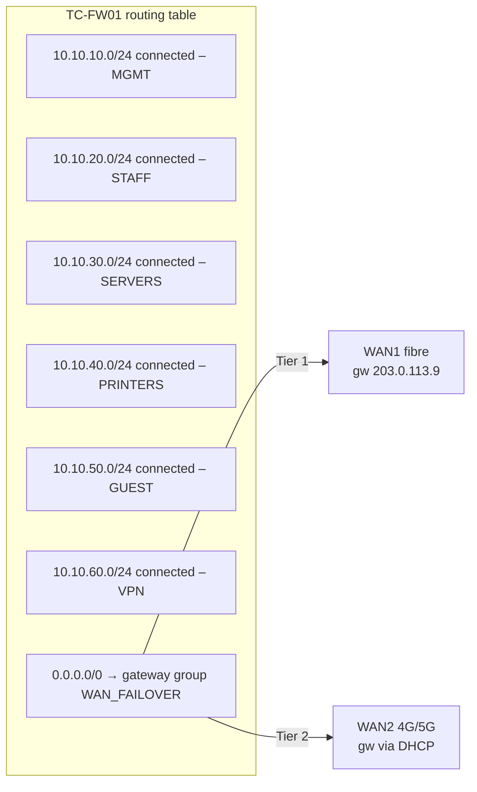

# Routing: Inter-VLAN, Internet and WAN Failover

| Field | Value |
|---|---|
| Document ID | NET-PRC-003 |
| Owner | IT Specialist |
| Status | Draft – becomes Approved after lab execution |
| Last reviewed | 2026-11-26 |
| Related requirements | BR-09, BR-15, BR-19, BR-25 |

## Purpose

Route between TechCorp's VLANs **through the firewall** (so every flow is
checked against a rule), give every VLAN internet access with NAT, and fail
over to 4G/5G automatically when the fibre line drops.

## 1. Routing design

| Decision | Reason |
|---|---|
| All internal subnets are **directly connected** to the firewall | No static routes or routing protocol needed in a one-site, one-router network |
| Hosts use `10.10.<VLAN>.1` as default gateway | Simple and identical rule in every VLAN |
| The switch does **not** route (`ip default-gateway`, no `ip routing`) | Inter-VLAN traffic cannot bypass the firewall |
| Default route via a **gateway group** | Automatic failover (BR-25) without manual intervention |
| Outbound NAT: automatic | pfSense NATs every internal subnet, including the VPN pool, to the active WAN address |

## 2. Procedure – pfSense

### 2.1 Interfaces and gateways

1. Configure VLAN interfaces as in [vlan-configuration.md](../vlans/vlan-configuration.md#4-production-configuration--tc-fw01-pfsense).
2. **Interfaces → WAN**: static `203.0.113.10/29`, upstream gateway
   `WAN_GW = 203.0.113.9`. Keep **Block private networks** and **Block bogon
   networks** ticked (production).
3. **Interfaces → WAN2** (USB/Ethernet 4G modem): DHCP. Gateway `WAN2_DHCP` is created automatically.
4. **System → Routing → Gateways** – set distinct **monitor IPs** so pfSense
   can tell which line is down:

   | Gateway | Monitor IP |
   |---|---|
   | WAN_GW | 1.1.1.1 |
   | WAN2_DHCP | 9.9.9.9 |

   *Why distinct:* pfSense adds a static route to each monitor IP via its
   gateway; using the same IP for both would break monitoring.

### 2.2 Failover group

1. **System → Routing → Gateway Groups → Add**: name `WAN_FAILOVER`,
   WAN_GW = Tier 1, WAN2_DHCP = Tier 2, trigger = *Packet Loss or High Latency*.
2. **System → Routing → Gateways → Default gateway IPv4** = `WAN_FAILOVER`.
3. In each internet-bound **pass** rule (see [firewall-rules.md](../firewall/firewall-rules.md))
   set *Advanced → Gateway* = `WAN_FAILOVER` (policy routing) – *except*
   rules whose destination is internal, which must keep gateway **default**,
   otherwise inter-VLAN traffic would be pushed out to the internet.
4. **System → Advanced → Miscellaneous**: tick *State Killing on Gateway Failure*
   so sessions move to the backup line instead of hanging.

### 2.3 NAT

**Firewall → NAT → Outbound**: leave *Automatic outbound NAT*. Verify the
auto-generated rules list `10.10.10.0/24` … `10.10.60.0/24` on both WAN and WAN2.

### 2.4 VPN routes (preview of remote access)

Remote-access VPN clients get `10.10.60.0/24` and a **split tunnel**: pushed
routes `10.10.30.0/24` (servers) and `10.10.40.0/24` (printers) only – M365
traffic goes straight to the internet from home. Full VPN build: `firewall/` in a later step.

## 3. Lab differences (VirtualBox)

| Production | Lab |
|---|---|
| WAN static 203.0.113.10/29 | WAN = VirtualBox NAT, DHCP `10.0.2.15`, gateway `10.0.2.2` |
| Block private networks on WAN | **Untick** in the lab – the VirtualBox NAT network is itself RFC 1918, so pfSense would drop everything |
| WAN2 4G | Second NAT adapter; failover tested by disconnecting adapter 1's cable in VirtualBox (*Devices → Network → Connect Network Adapter*) |
| VLAN sub-interfaces | One NIC per VLAN (`em1`–`em5`) on internal networks |

## 4. Verification

| Test | From | Command | Expected |
|---|---|---|---|
| Gateway reachable | Staff client | `Test-NetConnection 10.10.20.1` | `PingSucceeded : True` |
| Inter-VLAN path goes through firewall | Staff client | `tracert -d 10.10.30.11` | Hop 1 = 10.10.20.1, hop 2 = 10.10.30.11 |
| Internet | Staff client | `Test-NetConnection 1.1.1.1 -Port 443` | `TcpTestSucceeded : True` |
| Routing table | pfSense | *Diagnostics → Routes* | Connected routes for all 6 subnets, default via active gateway |
| Failover | pfSense + client | Disconnect WAN1 → watch *Status → Gateways*; keep `ping -t 1.1.1.1` running | WAN_GW goes *Offline*; ping resumes via WAN2 within ~10–30 s |
| Failback | | Reconnect WAN1 | Traffic returns to Tier 1 |

All of these are automated in
[Test-TechCorpNetwork.ps1](../../07-powershell/network-diagnostics/Test-TechCorpNetwork.ps1).

## 5. Troubleshooting

| Symptom | Likely cause | Fix |
|---|---|---|
| Internet works, other VLANs unreachable | Internal pass rule has a policy-routing gateway set | Remove gateway (use *default*) on internal-destination rules |
| Nothing from any VLAN reaches internet (lab) | *Block private networks* on WAN | Untick in lab only |
| Failover never triggers | Both gateways monitor the same IP, or monitoring disabled | Distinct monitor IPs |
| After failover, existing calls/sessions hang | States bound to dead WAN | Enable state killing on gateway failure |
| `tracert` shows hop 1 = 10.10.30.1 from a staff laptop | Laptop is in the wrong VLAN | Check switch port VLAN |
