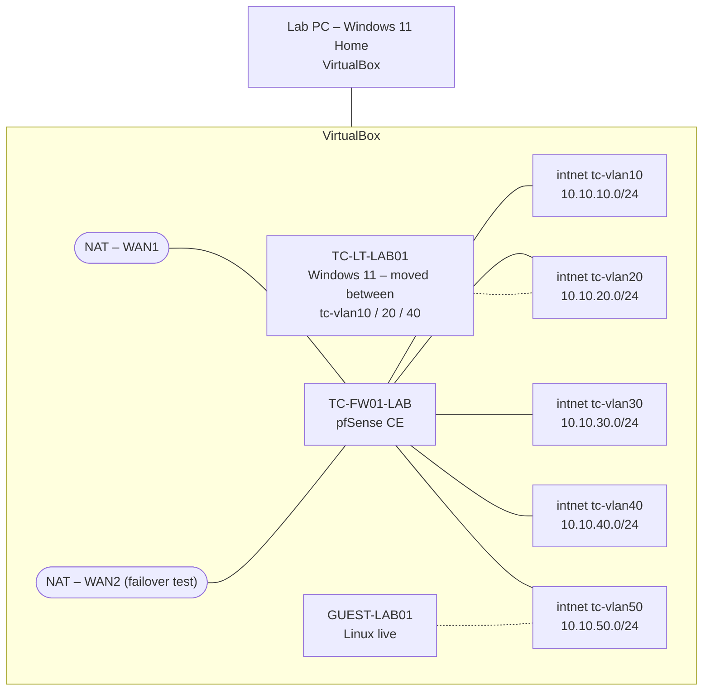

# Network Lab Environment (VirtualBox + Packet Tracer)

| Field | Value |
|---|---|
| Document ID | NET-PRC-006 |
| Owner | IT Specialist |
| Status | Draft – becomes Approved after the first full build |
| Last reviewed | 2026-11-26 |

## Purpose

Rebuild TechCorp's network on **one Windows 11 Home PC** so every procedure in
`02-network-infrastructure` can be executed and evidenced.

Windows 11 **Home has no Hyper-V**, so the lab uses:

| Tool | Version (tested target) | Used for |
|---|---|---|
| Oracle VirtualBox | 7.1.x (free) | pfSense firewall + client VMs with real operating systems |
| pfSense CE | 2.8.x (free) | TC-FW01: interfaces, DHCP (Kea), DNS Resolver, rules, NAT, failover |
| Windows 11 Enterprise Evaluation | 90-day ISO (free) | Staff/admin client `TC-LT-LAB01` |
| A small Linux live ISO (e.g. Debian/Alpine) | – | Guest client `GUEST-LAB01` |
| Cisco Packet Tracer | 8.2.x (free with Cisco NetAcad account) | Switch and router CLI: VLANs, trunks, STP, router-on-a-stick |

Host requirements: 4+ CPU cores, **8 GB RAM minimum** (pfSense 1 GB + Windows 11 4 GB + Linux 1 GB),
~60 GB free disk, virtualisation enabled in BIOS.

## 1. Lab topology



A VirtualBox **internal network** behaves like a VLAN with all ports in access
mode: VMs attached to `tc-vlan20` can only talk to each other and to pfSense's
STAFF interface. Trunking/tagging is practised in Packet Tracer instead.

## 2. Build the firewall VM

Download the pfSense CE installer (memstick/ISO, AMD64) from the Netgate site,
then in PowerShell (adjust `$iso`):

```powershell
$vbox = "$env:ProgramFiles\Oracle\VirtualBox\VBoxManage.exe"
$vm   = 'TC-FW01-LAB'
$iso  = "$HOME\Downloads\netgate-installer-amd64.iso"
$disk = "$HOME\VirtualBox VMs\$vm\$vm.vdi"

& $vbox createvm --name $vm --ostype FreeBSD_64 --register
& $vbox modifyvm $vm --memory 1024 --cpus 1 --firmware bios `
    --nic1 nat                          --nictype1 82540EM `
    --nic2 intnet --intnet2 tc-vlan10   --nictype2 82540EM `
    --nic3 intnet --intnet3 tc-vlan20   --nictype3 82540EM `
    --nic4 intnet --intnet4 tc-vlan30   --nictype4 82540EM `
    --nic5 intnet --intnet5 tc-vlan40   --nictype5 82540EM `
    --nic6 intnet --intnet6 tc-vlan50   --nictype6 82540EM `
    --nic7 nat                          --nictype7 82540EM
& $vbox createmedium disk --filename $disk --size 16384
& $vbox storagectl $vm --name SATA --add sata --controller IntelAhci
& $vbox storageattach $vm --storagectl SATA --port 0 --device 0 --type hdd --medium $disk
& $vbox storageattach $vm --storagectl SATA --port 1 --device 0 --type dvddrive --medium $iso
& $vbox startvm $vm
```

The VirtualBox GUI only shows 4 adapters; `VBoxManage` configures up to 8.
Adapters appear in pfSense in order as `em0` … `em6`:

| Adapter | pfSense | Interface name | IP |
|---|---|---|---|
| 1 (NAT) | em0 | WAN | DHCP (10.0.2.15) |
| 2 | em1 | LAN → rename **MGMT** | 10.10.10.1/24 |
| 3 | em2 | OPT1 → **STAFF** | 10.10.20.1/24 |
| 4 | em3 | OPT2 → **SERVERS** | 10.10.30.1/24 |
| 5 | em4 | OPT3 → **PRINTERS** | 10.10.40.1/24 |
| 6 | em5 | OPT4 → **GUEST** | 10.10.50.1/24 |
| 7 (NAT) | em6 | OPT5 → **WAN2** | DHCP |

## 3. Install and first boot

1. Run the installer (the current Netgate installer downloads pfSense CE, so
   WAN/NAT must have internet). Accept defaults, ZFS, single disk.
2. Detach the ISO, reboot. At the console menu choose **1) Assign Interfaces**:
   VLANs *no*, WAN = `em0`, LAN = `em1`, optional = `em2` … `em6`.
3. **2) Set interface IP address** → LAN: `10.10.10.1/24`, enable DHCP on LAN
   with range `10.10.10.100` – `10.10.10.150` (temporary, so the admin client gets an address).
4. Build `TC-LT-LAB01` (Windows 11 eval, 4 GB RAM, 2 vCPU, TPM 2.0 + Secure
   Boot enabled in VirtualBox 7) with one adapter on **intnet `tc-vlan10`**.
5. From `TC-LT-LAB01` browse to `https://10.10.10.1`, run the setup wizard:
   hostname `TC-FW01`, domain `corp.techcorp.example`, DNS `1.1.1.1`/`9.9.9.9`,
   time zone `Europe/Athens`, **untick "Block private networks" on WAN** (lab only – see routing doc).
6. Snapshot the VM: `VBoxManage snapshot TC-FW01-LAB take "01-base-install"`.

## 4. Build order

Follow the procedures in this order, snapshotting after each:

| # | Procedure | Snapshot name |
|---|---|---|
| 1 | Interfaces & IPs – [vlan-configuration.md §4](../vlans/vlan-configuration.md) | `02-interfaces` |
| 2 | DHCP – [dhcp-configuration.md](../dhcp/dhcp-configuration.md) | `03-dhcp` |
| 3 | DNS Resolver – [dns-design.md](../dns/dns-design.md) | `04-dns` |
| 4 | Gateways, failover, NAT – [inter-vlan-routing.md](../routing/inter-vlan-routing.md) | `05-routing` |
| 5 | Rules – [firewall-rules.md](../firewall/firewall-rules.md) | `06-rules` |
| 6 | Verify – run [Test-TechCorpNetwork.ps1](../../07-powershell/network-diagnostics/Test-TechCorpNetwork.ps1) from each VLAN | – |
| 7 | Switch CLI – [packet-tracer-lab](../packet-tracer-lab/) | save `.pkt` |

Moving the Windows client to another VLAN = change its adapter's internal
network name (*Settings → Network → Name*) – it works while the VM is running;
then `ipconfig /renew`.

## 5. Evidence to capture

Save to `15-documentation/screenshots/phase-01/` (sanitised):

- pfSense *Status → Interfaces*, *Status → DHCP Leases*, *Diagnostics → Routes*, *Status → Gateways* during failover
- `ipconfig /all` from STAFF and GUEST
- `Test-TechCorpNetwork.ps1` output CSV from each VLAN → `16-reports/` once complete
- Packet Tracer: `show vlan brief`, `show interfaces trunk`, `show ip interface brief`

## 6. Backing up the lab

*Diagnostics → Backup & Restore → Download configuration* after each stage.
The `config.xml` contains password hashes – keep it **outside** the repository
(`config*.xml` is also git-ignored as a safety net).
