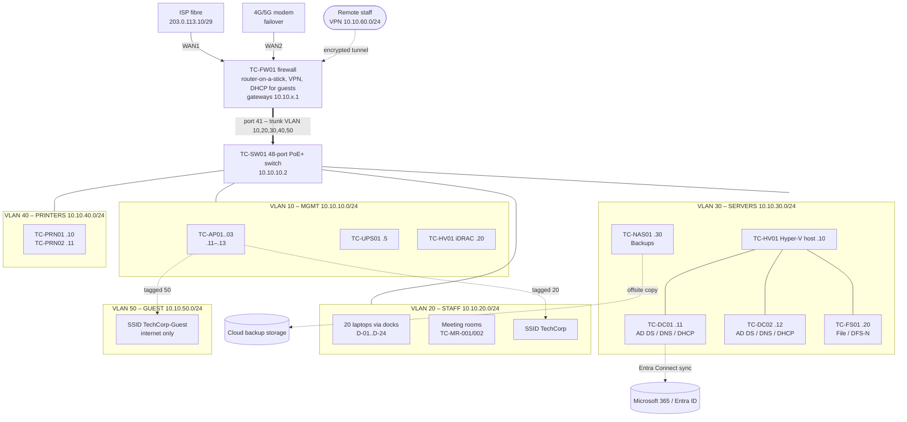
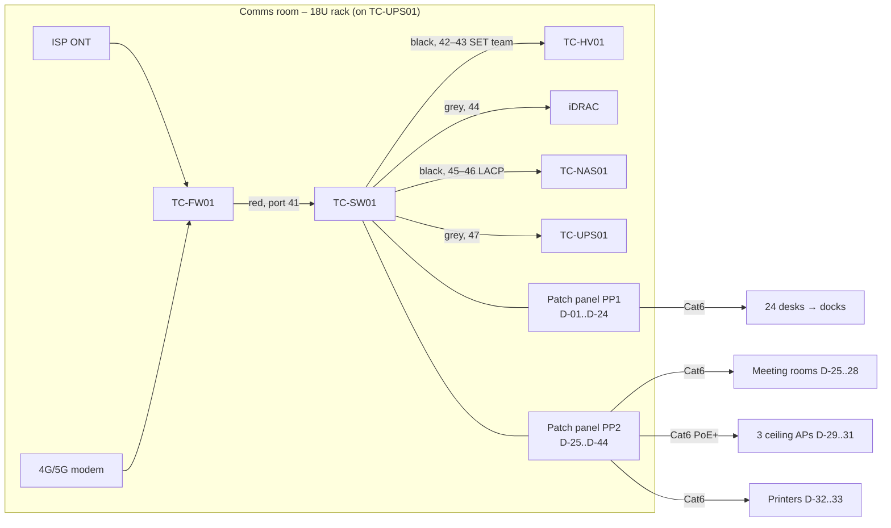

# Network Topology

| Field | Value |
|---|---|
| Document ID | NET-REF-001 |
| Owner | IT Specialist |
| Status | Approved (design) – to be built in Phase 1 |
| Last reviewed | 2026-11-26 |
| Related requirements | BR-05, BR-09, BR-15, BR-19, BR-25 |

## 1. Logical topology

## 2. Physical topology

## 3. Why this design

| Choice | Reason |
|---|---|
| Single switch, star topology | 33 active drops fit on one 48-port switch; no inter-switch links to troubleshoot |
| Firewall routes between VLANs (router-on-a-stick) | Every inter-VLAN flow passes a stateful firewall rule – meets BR-15 without a layer-3 switch |
| 1 Gbps trunk to firewall | Most traffic is to the internet (M365) or within VLAN 20/30 on the switch; upgrade path: 10G SFP+ if the trunk exceeds 60 % utilisation |
| Wi-Fi on the same VLANs as wired | Staff get identical access wired or wireless; guests are separated by VLAN, not only by SSID |
| Dual WAN | ISP outage fails over to 4G/5G automatically (BR-25) |

## 4. Lab equivalent

| Production | Lab (single PC) |
|---|---|
| TC-FW01 | pfSense CE VM with one WAN NIC (NAT) and one LAN NIC (internal switch, VLAN-tagged) |
| TC-SW01 + VLANs | Hyper-V internal switch with VLAN IDs per VM NIC; Cisco Packet Tracer for switch CLI practice |
| Wi-Fi APs | Documented only (SSID-to-VLAN logic simulated with VLAN-tagged VM NICs) |
| TC-HV01 | The lab PC itself (Hyper-V) |
| Laptops | Windows 11 VMs on VLAN 20 / 50 |
