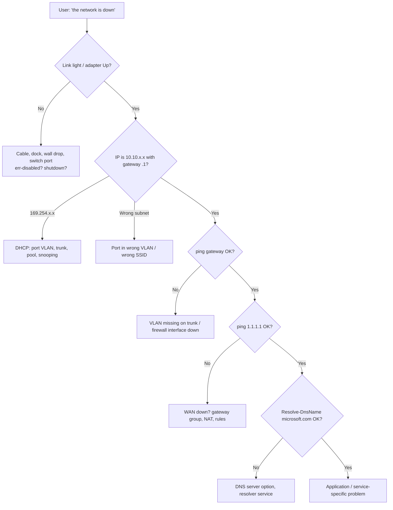

# Network Troubleshooting Method

| Field | Value |
|---|---|
| Document ID | NET-REF-005 |
| Owner | IT Specialist |
| Status | Approved |
| Last reviewed | 2026-11-26 |

## 1. The method: bottom-up, one layer at a time

Don't guess. Start at the cable and move up; the first layer that fails is
where the problem is.

| # | Layer | Question | Windows client | Switch (IOS) | pfSense |
|---|---|---|---|---|---|
| 1 | Physical | Is there link? | NIC light, `Get-NetAdapter` (Status Up, speed) | `show interfaces status` (connected / notconnect / err-disabled) | *Status → Interfaces* |
| 2 | Data link | Right VLAN? Is the MAC learnt? | `Get-NetAdapter \| select Name,MacAddress` | `show interfaces Gx switchport`, `show mac address-table interface Gx` | – |
| 3 | IP config | Valid address, mask, gateway? | `ipconfig /all` (169.254 = no DHCP) | `show ip dhcp snooping binding` | *Status → DHCP Leases* |
| 4 | Gateway | Can I reach the gateway? | `ping 10.10.x.1` | – | *Diagnostics → Ping* |
| 5 | Routing / policy | Can I reach the other subnet? Is a rule blocking? | `tracert -d <ip>`, `Test-NetConnection <ip> -Port <p>` | – | *Status → System Logs → Firewall* (blocked entries), *Diagnostics → States* |
| 6 | DNS | Does the name resolve to the right IP? | `Resolve-DnsName <name>`, `ipconfig /flushdns` | – | *Diagnostics → DNS Lookup* |
| 7 | Application | Is the service listening? | `Test-NetConnection <host> -Port 445` | – | *Diagnostics → Packet Capture* |

Shortcut used daily: **`ping` gateway → `ping` IP beyond it → `ping` a name.**
Which one fails tells you whether it is local, routing/rules, or DNS.

## 2. Quick decision tree



## 3. Command cheat sheet

### Windows

```powershell
ipconfig /all
ipconfig /release; ipconfig /renew
ipconfig /flushdns
Get-NetIPConfiguration
Test-NetConnection 10.10.30.20 -Port 445
Resolve-DnsName tc-sw01.corp.techcorp.example
tracert -d 10.10.30.11
arp -a
Get-NetNeighbor -AddressFamily IPv4
netsh wlan show interfaces          # Wi-Fi: SSID, BSSID (which AP), signal, channel
```

### Cisco switch

```text
show interfaces status
show interfaces status err-disabled
show interfaces Gi1/0/7 switchport
show vlan brief
show interfaces trunk
show mac address-table address <mac>
show spanning-tree vlan 20
show ip dhcp snooping binding
show logging
```

### pfSense

| Task | Where |
|---|---|
| Which rule blocked it? | *Status → System Logs → Firewall* (click the block icon for the rule) |
| Live connections | *Diagnostics → States*, filter by IP |
| Capture packets | *Diagnostics → Packet Capture* |
| Gateway status | *Status → Gateways* |
| Routes | *Diagnostics → Routes* |

## 4. Rules I follow

1. **Reproduce** before fixing; write the exact symptom in the ticket.
2. **One change at a time**, then retest.
3. **Ask "what changed?"** – most outages follow a change.
4. Record the fix in the ticket and, if new, as a scenario in `14-scenarios`.
5. Automate repeated checks – [Test-TechCorpNetwork.ps1](../../07-powershell/network-diagnostics/Test-TechCorpNetwork.ps1).
