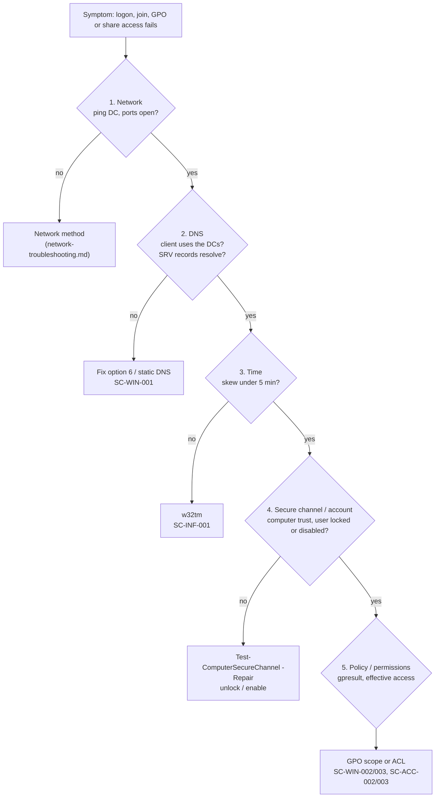

# Active Directory, DNS and Group Policy Troubleshooting

| Field | Value |
|---|---|
| Document ID | WIN-REF-005 |
| Owner | IT Specialist |
| Status | Draft – extended after every lab session |
| Last reviewed | 2026-11-27 |

Most "AD problems" are one of five things. Check them in this order – each
step depends on the one before it.

## 1. Command cheat sheet

| Question | Command |
|---|---|
| Which DC did I authenticate against? | `nltest /dsgetdc:corp.techcorp.example` · `$env:LOGONSERVER` |
| Do the SRV records resolve? | `Resolve-DnsName _ldap._tcp.dc._msdcs.corp.techcorp.example -Type SRV` |
| Is the DC healthy? | `dcdiag /s:TC-DC01 /q` · `dcdiag /test:dns /v` |
| Is replication working? | `repadmin /replsummary` · `repadmin /showrepl * /csv` · `Get-ADReplicationFailure -Scope Domain -Target corp.techcorp.example` |
| Force replication | `repadmin /syncall /AdeP` |
| FSMO holders | `netdom query fsmo` |
| Clock / time source | `w32tm /query /status` · `w32tm /stripchart /computer:TC-DC01 /samples:3` |
| Computer trust | `Test-ComputerSecureChannel -Verbose` · `-Repair -Credential TECHCORP\wadm-eren.yeager` |
| Locked-out users | `Search-ADAccount -LockedOut` · `Get-ADUser <u> -Properties LockedOut, BadLogonCount, LastBadPasswordAttempt` |
| Where did the lockout come from? | Security log on the **PDC emulator**, event **4740** → *Caller Computer Name* |
| My group memberships (token) | `whoami /groups` · `klist` · `klist purge` (then re-access) |
| Which GPOs applied, and why not? | `gpresult /r` · `gpresult /h $env:TEMP\gp.html` · `Get-GPResultantSetOfPolicy` |
| Re-apply policy | `gpupdate /force` (user part needs log off for drive maps / folder redirection) |
| Effective NTFS access | File *Properties → Security → Advanced → Effective Access* · `Get-Acl <path> \| Format-List` |
| Compare domain with the plan | [Test-TechCorpAd.ps1](../../07-powershell/active-directory/Test-TechCorpAd.ps1) |

## 2. Useful event IDs

| Log | ID | Meaning |
|---|---|---|
| Security (DC) | 4740 | Account locked out (PDC has every lockout) |
| Security (DC) | 4771 | Kerberos pre-authentication failed (0x18 = wrong password, 0x25 = clock skew) |
| Security (DC) | 4625 | Failed logon (on the computer where it happened) |
| Security (DC) | 4720 / 4726 / 4728 / 4732 | User created / deleted / added to global / domain local group (audit GPO) |
| System (client) | 5719 | Netlogon could not reach a DC (DNS or network) |
| System (client) | 1129 / 1058 / 1030 | Group Policy cannot reach DC / read `gpt.ini` / retrieve policies |
| Group Policy operational | 4016 / 5016 | Per-extension processing start / end – shows which CSE failed |
| Directory Service (DC) | 1311 / 1865 | Replication topology problem |
| DFS Replication (DC) | 4012 | SYSVOL replication stopped – DC offline longer than 60 days |
| Directory Service (DC) | 2095 | USN rollback detected – DC restored from a snapshot |

## 3. Symptom → cause table

| Symptom | Most likely cause | Check / fix |
|---|---|---|
| "The specified domain either does not exist or could not be contacted" (join) | Client DNS is the firewall or a public resolver | `Get-DnsClientServerAddress`; DHCP option 6 → DCs (SC-WIN-001) |
| "There are currently no logon servers available" | DC unreachable or DNS wrong; cached logon only | `nltest /dsgetdc:`; firewall STAFF rule 3 (PORTS_AD) |
| "The trust relationship between this workstation and the primary domain failed" | Computer password out of sync (restored image/snapshot) | Sign in with LAPS local admin → `Test-ComputerSecureChannel -Repair` |
| "The time difference between the client and server is too large" / 4771 0x25 | Clock skew > 5 min | `w32tm /resync`; host time sync disabled on DCs (SC-INF-001) |
| User keeps getting locked out | Old password on a phone / mapped drive / saved credential | 4740 on PDC (SC-ACC-001) |
| Just added to a group, still "Access denied" | Kerberos ticket still holds the old token | Log off/on, or `klist purge` (SC-ACC-002) |
| GPO shows in GPMC but `gpresult` lists it under *Denied (Security)* or not at all | Security filtering removed Authenticated Users' Read (MS16-072) | SC-WIN-002 |
| User settings of a GPO never apply | GPO linked to a computer OU | Link where the users are (SC-WIN-003) |
| Mapped drive missing for one department | Item-level targeting group typo | GPP drive map → *Common → Targeting* |
| New DC does not replicate after a restore | USN rollback (event 2095) | Demote/rebuild the DC – never restore DC snapshots |
| Deleted user needs to come back | – | AD Recycle Bin (SC-ACC-004) |
