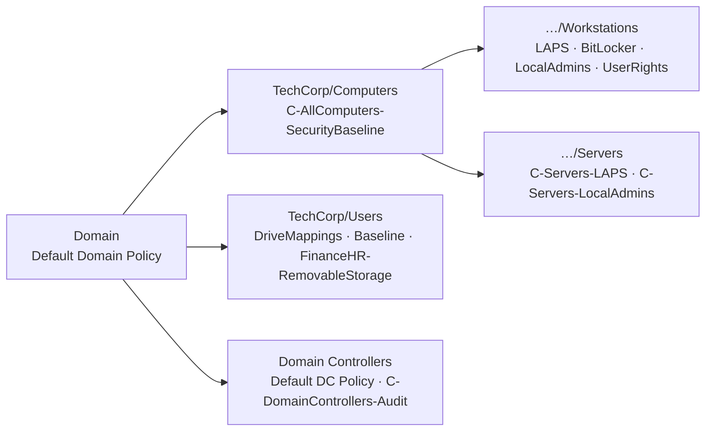

# Group Policy Design

| Field | Value |
|---|---|
| Document ID | WIN-REF-003 |
| Owner | IT Specialist |
| Status | Approved design – lab build pending |
| Last reviewed | 2026-11-27 |
| Related requirements | BR-03, BR-12, BR-14, BR-15, BR-18, BR-26 |
| Source data | [gpo-plan.csv](gpo-plan.csv) · [gpo-registry-settings.csv](gpo-registry-settings.csv) |

## 1. Principles

| Principle | In practice |
|---|---|
| **One purpose per GPO** | `C-Workstations-BitLocker` contains BitLocker and nothing else – easy to find, test, disable and roll back |
| Name says what and where | `<C\|U>-<Scope>-<Purpose>` ([naming-conventions.md](../../15-documentation/standards/naming-conventions.md#5-group-policy-objects)) |
| Unused half disabled | Computer GPOs have *User settings disabled* and vice versa – faster processing, no accidental mix |
| **Link where the objects are** | Computer GPOs on `TechCorp/Computers/…`, user GPOs on `TechCorp/Users` (CI enforces it) |
| Default GPOs stay minimal | *Default Domain Policy* = password/lockout/Kerberos only; *Default Domain Controllers Policy* untouched |
| Target with OUs first, security filtering second, item-level targeting for preferences | No WMI filters (slow, hard to troubleshoot) |
| No *Enforced*, no *Block inheritance* | Except *Block inheritance* on `TechCorp/Disabled` |
| Security filtering keeps **Authenticated Users: Read** | Since MS16-072 user policies are read in the computer's context – without Read the GPO silently disappears (SC-WIN-002) |
| Settings as data | Registry-based settings live in `gpo-registry-settings.csv` and are written by `Deploy-TechCorpGpo.ps1`; the rest is click-by-click in [gpo-procedures.md](gpo-procedures.md) |
| Backed up | `Backup-GPO -All` after every change, kept off the DC (Phase 10) |

## 2. Processing order

Local → Site → Domain → OU (parent → child). Later wins on conflicts. For
TechCorp only the domain and OU levels are used:

## 3. GPO catalogue

| GPO | Linked to | Filtering | Method | Settings | BR |
|---|---|---|---|---|---|
| Default Domain Policy | domain | Authenticated Users | Manual | Password/lockout policy ([user-accounts.md §3](../users-and-groups/user-accounts.md#3-password-and-lockout-policy)) | 14 |
| Default Domain Controllers Policy | Domain Controllers | Authenticated Users | – | Defaults | – |
| C-DomainControllers-Audit | Domain Controllers | Authenticated Users | Manual | Advanced audit policy, 1 GB Security log | 18 |
| C-AllComputers-SecurityBaseline | Computers | Authenticated Users | Script | LLMNR off, NTLMv2 only, SMB signing, firewall on, 10-min lock, logon banner | 14, 15 |
| C-Workstations-LAPS | Workstations | Authenticated Users | Script | Windows LAPS → AD, 16 chars, 30 days, encrypted, `GG_IT_WorkstationAdmins` decrypt, reset + log off 8 h after use | 14 |
| C-Servers-LAPS | Servers | Authenticated Users | Script | Windows LAPS → AD, 20 chars, decrypt = Domain Admins | 14 |
| C-Workstations-LocalAdmins | Workstations | Authenticated Users | Manual | Local Administrators = LAPS Administrator + `GG_IT_WorkstationAdmins` | 14 |
| C-Servers-LocalAdmins | Servers | Authenticated Users | Manual | Local Administrators = Administrator + Domain Admins + `GG_IT_ServerAdmins` | 14 |
| C-Workstations-UserRights | Workstations | Authenticated Users | Manual | Deny Domain/Enterprise/Schema Admins local, RDP, batch, service logon (WIN-CHG-001) | 14 |
| C-Workstations-BitLocker | Workstations | Authenticated Users | Script | XTS-AES 256, recovery password escrowed to AD **before** encryption | 12 |
| U-AllUsers-DriveMappings | Users | Authenticated Users | Manual | Drive maps (below) | 3 |
| U-AllUsers-Baseline | Users | Authenticated Users | Script | Locked screen saver 10 min, AutoRun off | 14 |
| U-FinanceHR-RemovableStorage | Users | `GG_Finance_Users`, `GG_HR_Users` (+ AU Read) | Script | Removable disks: deny write | 26 |
| C-Workstations-OneDrive (M6) | Workstations | Authenticated Users | Script | Silent sign-in, Known Folder Move (tenant ID via `-TenantId`), Files On-Demand | 3, 20 |
| U-AllUsers-Printers (M6) | Users | Authenticated Users | Manual | GPP shared printers from TC-FS01 ([printing.md](../../04-endpoint-management/printers/printing.md)) | 6 |

The exact registry values (key, value, type, data, and the GPMC setting name
they correspond to) are in [gpo-registry-settings.csv](gpo-registry-settings.csv).

### Why these settings

| Setting | Threat it removes |
|---|---|
| LLMNR off | Responder-style poisoning: any machine on the VLAN answers a mistyped share name and captures the NTLM hash |
| NTLMv2 only (`LmCompatibilityLevel 5`) | LM / NTLMv1 hashes are crackable in minutes |
| SMB signing required (client + server) | NTLM relay to file shares; already the default on Windows 11 24H2 / Server 2025 – the GPO makes it explicit and survives an older image |
| Firewall on, all profiles | A "temporary" disabled firewall becoming permanent |
| 10-minute lock | Unattended unlocked laptops in an open-plan office |
| LAPS | One shared local admin password across all laptops = one stolen hash opens all of them |
| Deny DA logon on workstations | Domain Admin credentials cached on the most exposed machines |
| BitLocker escrow first | An encrypted laptop whose key is lost is a lost laptop |
| Removable storage deny write (Finance/HR) | Personal data / payroll on a USB stick (GDPR, BR-26) |

## 4. Drive mappings (`U-AllUsers-DriveMappings`)

Group Policy Preferences → *User Configuration → Preferences → Windows
Settings → Drive Maps*, action **Update**, *Reconnect* ticked, item-level
targeting by **security group**. Paths use the DFS namespace so the file
server can be replaced without touching the GPO.

| Drive | Path | Label | Targeting |
|---|---|---|---|
| S: | `\\corp.techcorp.example\dfs\Company` | Company | GG_All_Staff |
| T: | `\\corp.techcorp.example\dfs\Departments\Management` | Management | GG_Management_Users |
| T: | `\\corp.techcorp.example\dfs\Departments\Finance` | Finance | GG_Finance_Users |
| T: | `\\corp.techcorp.example\dfs\Departments\HR` | HR | GG_HR_Users |
| T: | `\\corp.techcorp.example\dfs\Departments\Sales` | Sales | GG_Sales_Users |
| T: | `\\corp.techcorp.example\dfs\Departments\Development` | Development | GG_Development_Users |
| T: | `\\corp.techcorp.example\dfs\Departments\Support` | Support | GG_Support_Users |
| M: | `\\corp.techcorp.example\dfs\Managers` | Managers | GG_All_Managers |
| P: | `\\corp.techcorp.example\dfs\Departments\HR\Payroll-Inputs` | Payroll inputs | GG_Finance_Payroll |
| I: | `\\corp.techcorp.example\dfs\IT` | IT | GG_IT_Users |

P: points **directly** at the subfolder: payroll staff cannot browse
`Departments\HR` (no access), but Windows' *Bypass traverse checking* right
lets them open the path below it (SC-ACC-003).

## 5. What is not a GPO here

| Topic | Where | Phase |
|---|---|---|
| Windows Update rings | Windows Update for Business / Intune | 4, 6 |
| Defender settings | Defender for Business / Intune | 9 |
| OneDrive Known Folder Move | Intune / GPO once M365 exists | 5 |
