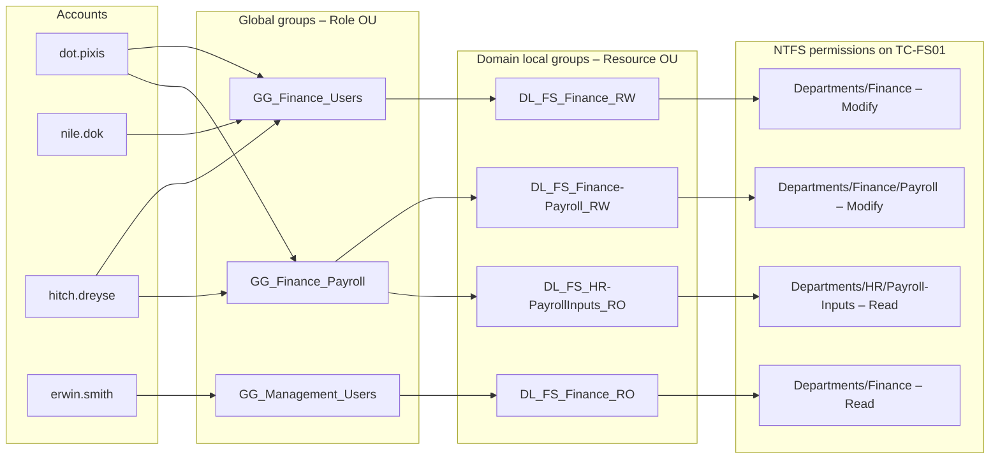

# Security Groups and AGDLP

| Field | Value |
|---|---|
| Document ID | WIN-REF-002 |
| Owner | IT Specialist |
| Status | Approved design – lab build pending |
| Last reviewed | 2026-11-27 |
| Related requirements | BR-03, BR-14, BR-26 |
| Source data | [ad-groups.csv](ad-groups.csv) |

## 1. The rule

**A**ccounts go into **G**lobal groups (who they are), global groups go into
**D**omain **L**ocal groups (what they can access), and only domain local
groups appear on **P**ermissions.

Why bother, for 20 people?

| Without AGDLP | With AGDLP |
|---|---|
| A new accountant is added to 4 ACLs on the file server | A new accountant is added to **one** group (`GG_Finance_Users`) |
| "Who can open Payroll?" = read every ACL | "Who can open Payroll?" = `Get-ADGroupMember DL_FS_Finance-Payroll_RW -Recursive` |
| ACLs change every time someone joins or leaves – risky, slow, unaudited | ACLs are written **once** by a script and never touched again |
| A leaver's SID stays on ACLs as "Account Unknown" | Leavers just disappear from groups |

## 2. Groups

Generated from [ad-groups.csv](ad-groups.csv); `@department` means "every
employee whose department maps to this group in
[department-map.csv](department-map.csv)".

### Role groups (Global, `TechCorp/Groups/Role`)

| Group | Members | Used for |
|---|---|---|
| `GG_Management_Users` … `GG_IT_Users` (7) | Each department's employees | Department folders, drive mapping targeting |
| `GG_All_Staff` | The 7 department groups | Company share, Departments root |
| `GG_All_Managers` | Everyone with direct reports in `employees.csv` (7) – CI checks this | Managers share |
| `GG_Finance_Payroll` | `dot.pixis`, `hitch.dreyse` | Payroll folder, HR payroll inputs |

### Licensing group (Global, `TechCorp/Groups/Licensing`, synced)

| Group | Members | Used for |
|---|---|---|
| `LIC_M365_BusinessPremium` | Every employee **directly** (`@employees`) – Entra group-based licensing ignores nested members | Microsoft 365 Business Premium ([licensing-and-lifecycle.md](../../05-microsoft-365/user-management/licensing-and-lifecycle.md)) |

### Admin groups (Global, `TechCorp/Admin/Groups`)

| Group | Members | Grants |
|---|---|---|
| `GG_IT_AdminAccounts` | `adm-eren.yeager`, `wadm-eren.yeager` | Target of `PSO-AdminAccounts` (stronger password policy) |
| `GG_IT_ServerAdmins` | `adm-eren.yeager` | Local Administrators on member servers |
| `GG_IT_WorkstationAdmins` | `wadm-eren.yeager` | Local Administrators on laptops; LAPS read/reset; join computers |
| `GG_IT_HelpdeskOperators` | `wadm-eren.yeager` | Reset passwords / unlock in `TechCorp/Users` |

Built-in groups used: `Domain Admins` (`adm-eren.yeager` + the break-glass built-in Administrator) and
`Protected Users` (`adm-eren.yeager`). No one is in `Enterprise Admins` or
`Schema Admins` day to day – add temporarily for a schema change, remove after.

### Resource groups (Domain local, `TechCorp/Groups/Resource`)

| Group | Members | Folder | Access |
|---|---|---|---|
| `DL_FS_Company_RO` | GG_All_Staff | Company | Read |
| `DL_FS_Company_RW` | GG_Management_Users, GG_HR_Users | Company | Modify |
| `DL_FS_Departments_List` | GG_All_Staff | Departments (this folder only) | List |
| `DL_FS_<Dept>_RW` (6) | `GG_<Dept>_Users` | `Departments\<Dept>` | Modify |
| `DL_FS_Finance_RO` | GG_Management_Users | Departments\\Finance | Read |
| `DL_FS_Finance-Payroll_RW` | GG_Finance_Payroll | Departments\\Finance\\Payroll | Modify |
| `DL_FS_HR-PayrollInputs_RO` | GG_Finance_Payroll | Departments\\HR\\Payroll-Inputs | Read |
| `DL_FS_Managers_RW` | GG_All_Managers | Managers | Modify |
| `DL_FS_IT_RW` | GG_IT_Users | IT | Modify |

## 3. Rules enforced in CI

`Get-TechCorpAdPlan.ps1 -SelfTest` fails the build if any of these break:

- Names follow `GG_<Department>_<Role>` / `DL_<Type>_<Resource>[-]_<RW|RO|List>`, and the suffix matches the access actually granted.
- `GG_` groups are Global and live in `Role` or `Admin/Groups`; `DL_` groups are Domain Local and live in `Resource`.
- A domain local group contains **only** `GG_` groups – never a user.
- A global group contains users or other `GG_` groups – never a `DL_`.
- Privileged accounts are only in admin groups, and admin groups contain only privileged accounts.
- No nesting loops; every department group is nested in `GG_All_Staff`.
- Every `DL_FS_` group is used on at least one folder; every folder grant uses a `DL_FS_` group.
- Every expected result in [access-tests.csv](../permissions/access-tests.csv) holds.

## 4. Operational notes

- **Group changes need a new logon.** Membership is read into the Kerberos
  ticket at logon; a user added to a group at 10:00 still has the old token
  until they sign out/in (or `klist purge` + reconnect). See SC-ACC-002.
- **Don't use `Domain Users` on ACLs.** It includes every account, including
  admin and service accounts – use `GG_All_Staff`.
- Changes go through the CSV: edit → CI → `Deploy-TechCorpAd.ps1`. A manual
  change in ADUC will show up as `WARN unexpected member` on the next run.
- Quarterly access review (BR-26): export `Get-ADGroupMember -Recursive` for
  every `DL_FS_` group and have each department manager confirm their list.
