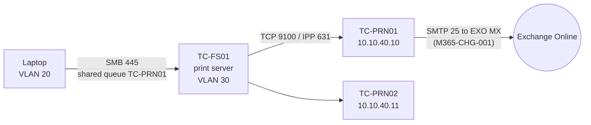

# Printing and Scan-to-E-mail

| Field | Value |
|---|---|
| Document ID | END-PRC-004 |
| Owner | IT Specialist |
| Status | Draft – becomes Approved after the first lab build |
| Last reviewed | 2026-11-27 |
| Related requirements | BR-06, BR-15, BR-26 |

## Design

| Device | Where | Who | Queue | Driver |
|---|---|---|---|---|
| TC-PRN01 – colour MFP | Open-plan print area, 10.10.40.10 | All staff (default printer) | `\\TC-FS01\TC-PRN01` | Vendor universal PCL6 / Type 4 |
| TC-PRN02 – mono laser | Finance office, 10.10.40.11 | Finance only | `\\TC-FS01\TC-PRN02` | Vendor universal PCL6 / Type 4 |

### Design change END-CHG-001 – print server on TC-FS01

M3/M4 assumed laptops print directly to the printers' IPs. Writing the
deployment showed three problems: every laptop would need the driver installed
by an administrator (Point-and-Print hardening since 2021 blocks users from
installing printer drivers), access to TC-PRN02 could not be restricted to
Finance, and there would be no central place to see the queues.

**END-CHG-001:** the *Print and Document Services* role on TC-FS01 hosts both
queues; laptops connect to `\\TC-FS01\<queue>` (SMB, already allowed), and
**only TC-FS01 talks to VLAN 40**. Queue permissions restrict TC-PRN02 to
`GG_Finance_Users` (+ admins). Drivers are installed once on the server and
are allow-listed for Point-and-Print via GPO.



Universal Print (cloud printing, included in Business Premium) was
considered; it removes the print server but needs a connector or
Universal-Print-ready printers, and the file server is already there. It is
the planned option when TC-FS01 is retired.

## Procedure

1. **Role and queues** on TC-FS01 (lab: no physical printer – use the inbox
   *Generic / Text Only* driver; the queue and its permissions are what's tested):

   ```powershell
   Install-WindowsFeature Print-Server -IncludeManagementTools
   Add-PrinterDriver -Name 'Generic / Text Only'          # production: vendor universal driver
   foreach ($p in @(@{ Name = 'TC-PRN01'; Ip = '10.10.40.10' }, @{ Name = 'TC-PRN02'; Ip = '10.10.40.11' })) {
       Add-PrinterPort -Name "IP_$($p.Ip)" -PrinterHostAddress $p.Ip
       Add-Printer -Name $p.Name -DriverName 'Generic / Text Only' -PortName "IP_$($p.Ip)" -Shared -ShareName $p.Name -Published
   }
   ```

2. **Restrict TC-PRN02** – *Print Management → TC-PRN02 → Properties →
   Security*: remove *Everyone*, add `TECHCORP\GG_Finance_Users` (*Print*),
   keep Administrators (*Manage printers/documents*).
   (PowerShell: build the SDDL and use `Set-Printer -Name TC-PRN02 -PermissionSDDL <sddl>`; record the final SDDL in the ticket.)

3. **Firewall:** pfSense *PRINTERS* and *STAFF* rules – `STAFF → NET_PRINTERS` (PORTS_PRINT) is no longer needed; leave it disabled rather than deleted for one month, then remove.

4. **GPO `U-AllUsers-Printers`** (Manual, in [gpo-plan.csv](../../03-windows-server/group-policy/gpo-plan.csv)):
   *User Configuration → Preferences → Control Panel Settings → Printers →
   New → Shared Printer*:
   - `\\TC-FS01\TC-PRN01`, action **Update**, *Set this printer as the default printer*, targeting `GG_All_Staff`.
   - `\\TC-FS01\TC-PRN02`, action **Update**, targeting `GG_Finance_Users`.

5. **Point-and-Print allow-list** – add to `C-AllComputers-SecurityBaseline` by
   hand (*Computer Configuration → Administrative Templates → Printers →
   Point and Print Restrictions*): *Users can only point and print to these
   servers* = `TC-FS01.corp.techcorp.example`; both prompts *Show warning and
   elevation prompt*. Keep *Limits print driver installation to Administrators*
   **enabled** (the PrintNightmare fix).

6. **Scan-to-e-mail** – see [exchange-online.md §5](../../05-microsoft-365/exchange-online/exchange-online.md#5-scan-to-e-mail-from-tc-prn01-m365-chg-001):
   the MFP sends as `scanner@techcorp.example` through an inbound connector.

## Verification

| Test | Expected |
|---|---|
| `nile.dok` signs in | Both printers present, TC-PRN01 default |
| `connie.springer` signs in | Only TC-PRN01 |
| `Add-Printer -ConnectionName \\TC-FS01\TC-PRN02` as connie.springer | Access denied |
| Print a test page from Notepad | Job appears in `Get-PrintJob -ComputerName TC-FS01 -PrinterName TC-PRN01` |
| Scan to own address | E-mail arrives, not in Junk, SPF pass in the headers |

## Troubleshooting

| Symptom | Likely cause | Fix |
|---|---|---|
| "Windows needs to install a driver… administrator" | Driver not on the server or not allow-listed | Step 5; driver on TC-FS01 |
| Printer missing for one department | GPP targeting group | Check `U-AllUsers-Printers` item targeting; log off/on |
| Jobs stuck "Error – Printing" | Server cannot reach the printer | From TC-FS01: `Test-NetConnection 10.10.40.10 -Port 9100` |
| Spooler crashes | Bad third-party driver | `Restart-Service Spooler`; replace with the universal driver |
| Scans land in Junk | Public IP not in SPF, connector missing | SC-M365-002 |
