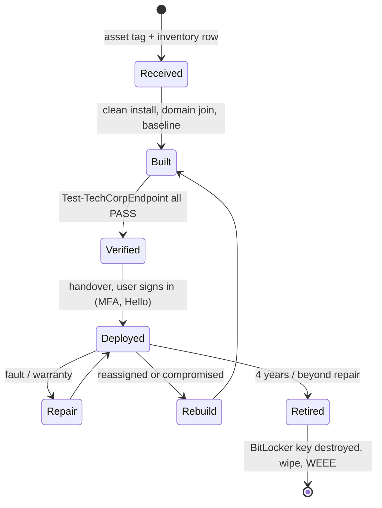

# Windows 11 Deployment Strategy

| Field | Value |
|---|---|
| Document ID | END-REF-001 |
| Owner | IT Specialist |
| Status | Approved design – lab build pending |
| Last reviewed | 2026-11-27 |
| Related requirements | BR-01, BR-04, BR-10, BR-12, BR-14, BR-32, BR-33 |

## 1. Decision

| Question | Decision | Why |
|---|---|---|
| How is Windows installed? | **Clean install** from current Microsoft media on every new laptop (no OEM image) | Removes vendor bloatware; one known state for 22 laptops |
| How does a laptop become "TechCorp"? | **Domain join** to `corp.techcorp.example` → GPOs → `Install-TechCorpBaseline.ps1` | Reuses everything from M5; no extra licence or tool |
| Identity on the device | **Hybrid Microsoft Entra join** (AD-joined, registered in Entra ID by Entra Connect) | Keeps GPOs, drive maps and Kerberos to the file server *and* gives single sign-on to Microsoft 365 (Primary Refresh Token) |
| Software | winget + Office Deployment Tool, driven by [app-catalogue.csv](../software-installation/app-catalogue.csv) | Scriptable, repeatable, free; Intune Win32 apps take over in M7 |
| Updates | Windows Update (GPO-free for now) → Windows Update for Business rings in Intune (M7) | One mechanism instead of WSUS on a 20-user site |
| Evidence | `Test-TechCorpEndpoint.ps1` CSV attached to the build ticket | A build is "done" when the check is green, not when it "looks fine" |

### Options considered

| Option | Verdict |
|---|---|
| Golden image (capture + deploy with MDT/WDS) | Rejected – MDT is retired; image maintenance is a monthly job for one person |
| **Windows Autopilot, Entra-joined (cloud-only device)** | **Target for refreshes from 2027** once Intune is live (M7) and the file server is mostly replaced by SharePoint. Needs no line of sight to a DC |
| Windows Autopilot, hybrid join | Rejected – needs the Intune Connector for AD, a line of sight to a DC during OOBE, and Microsoft steers new deployments to Entra join |
| Domain join + provisioning script | **Chosen for the first fleet** – works with what M5 built, fully documented, quick to rebuild |

## 2. Device lifecycle states

`Status` in [hardware-inventory.csv](../../01-office-deployment/equipment-inventory/hardware-inventory.csv)
follows these states (currently all `Planned`).

## 3. What is done where

| Layer | Configured by | Document |
|---|---|---|
| Firmware (Secure Boot, TPM, BIOS password) | Hand, per model | [laptop-build.md](laptop-build.md) |
| Windows edition, hostname, domain join, OU | Build procedure | [laptop-build.md](laptop-build.md) |
| Security baseline, LAPS, BitLocker policy, local admins, OneDrive KFM | GPO | [gpo-design.md](../../03-windows-server/group-policy/gpo-design.md) |
| Hybrid join | Entra Connect (device sync + SCP) | [entra-connect-sync.md](../../05-microsoft-365/entra-connect/entra-connect-sync.md) |
| Applications | `Install-TechCorpBaseline.ps1` | [software-deployment.md](../software-installation/software-deployment.md) |
| Drivers and firmware updates | Windows Update + vendor tool | [drivers-and-firmware.md](../drivers/drivers-and-firmware.md) |
| Printers | GPO from the TC-FS01 print server | [printing.md](../printers/printing.md) |
| Compliance, Defender onboarding, update rings | Intune | M7 |
